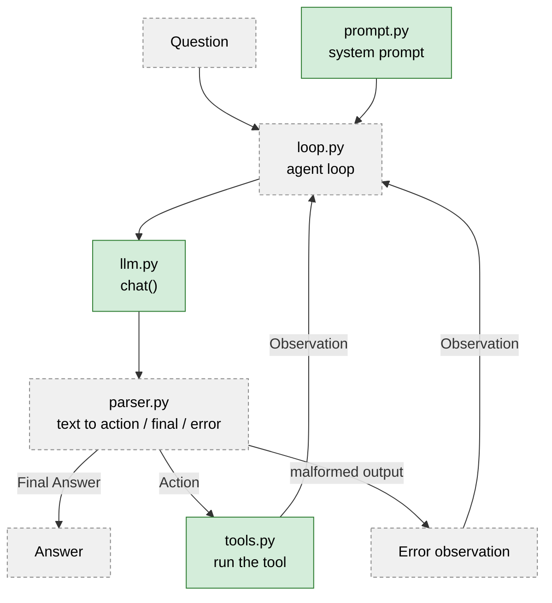

# ReAct Agent From Scratch

A ReAct (Reasoning + Acting) agent built in plain Python, without agent frameworks. The model reasons in text, picks a tool, receives the tool result as an observation, and repeats until it can give a final answer.

**Status:** work in progress. The model wrapper, the tools and the system prompt are done and tested. The output parser and the agent loop come next.



Green boxes are implemented. Dashed grey boxes are planned.

## What is ReAct?

ReAct ([Yao et al., 2022](https://arxiv.org/abs/2210.03629)) makes a language model alternate between thinking and acting. The model is asked to write this format:

```
Thought: I need the height of the Eiffel Tower first.
Action: search
Action Input: height of eiffel tower
Observation: The Eiffel Tower is about 330 meters tall.   <- written by the program, not the model
Thought: Now I can double it.
Action: calculator
Action Input: 330*2
Observation: 660
Thought: I now know the final answer
Final Answer: 660 meters
```

The program reads `Action` and `Action Input`, runs the tool, appends the `Observation`, and calls the model again.

## What works today

| Module | Job |
|---|---|
| `llm.py` | One `chat()` function that talks to a model. The model name comes from `.env`, so nothing is hard-coded. |
| `tools.py` | Three tools: a safe calculator, a fake offline search, and a sandboxed file reader. |
| `prompt.py` | Builds the system prompt (format + rules + tool list) from the list of tools. |

```python
from react_agent.tools import TOOLS, calculator, file_lookup
from react_agent.prompt import build_system_prompt

calculator("2+3*4")                 # '14'
file_lookup("notes.txt")            # reads data/notes.txt
print(build_system_prompt(TOOLS))   # the system prompt the model receives
```

## Quick start

Requirements: Python 3.13+, [uv](https://docs.astral.sh/uv/) and [Ollama](https://ollama.com).

```bash
git clone https://github.com/sadrjahani/react-agent-from-scratch.git
cd react-agent-from-scratch

uv sync                      # create the environment from uv.lock
ollama pull qwen3:8b         # download a local model (about 5 GB)
cp .env.example .env         # PowerShell: Copy-Item .env.example .env
```

Edit `.env`:

```
LLM_PROVIDER=ollama
LLM_MODEL=qwen3:8b
```

Check the connection and run the tests:

```bash
uv run python -m react_agent.llm     # prints a short greeting from the model
uv run pytest -q                     # no model or network needed
uv run ruff check .
```

To try another model for a single run (PowerShell): `$env:LLM_MODEL="llama3.2"`.

## Project structure

```
src/react_agent/
    llm.py        model wrapper
    tools.py      calculator, search, file_lookup + Tool registry
    prompt.py     system prompt builder
tests/            unit tests (fake clients, no network)
data/notes.txt    sample file for the file tool (the tool's sandbox folder)
.env.example      settings template (no secrets)
```

## Design decisions

### Why open models, run locally?

- **Free and private.** No API key, no per-token cost, nothing leaves the machine. Anyone can clone the repo and run it.
- **Reproducible.** A pinned local model name in `.env` plus `uv.lock` makes runs repeatable.
- **Honest about small models.** Local models are smaller, so they follow strict formats less reliably. That makes the weak points of an agent (parsing, error recovery) visible instead of hiding them behind a very strong model.

I treat model choice as a setting, not as code:

| Model | Why it is in the project |
|---|---|
| `phi4-mini` | Very small and fast; a baseline that shows how much format discipline a tiny model has. |
| `qwen3:8b` | Main candidate: larger, instruction-following, about 5 GB on disk. |
| `llama3.2` | Second comparison model. |

A comparison table (turns to answer, parse errors, success) will be added once the agent loop exists and I have real traces. Check each model's license on its Ollama page before reuse.

### Why one OpenAI-compatible client for Ollama?

Ollama exposes an OpenAI-compatible endpoint (`/v1`). Using one standard client means the wrapper stays small, and the same code can talk to other servers with that API later. The rest of the project only calls `chat(messages, system, temperature, stop)`.

Two parameters matter for an agent:

- `temperature=0.0` keeps output as repeatable as possible, which helps a model stick to a strict format.
- `stop=["Observation:"]` cuts generation before the model can invent a tool result itself.

### Why build it from scratch?

To understand exactly what an agent framework does for you: prompting, parsing, the loop, tool calls, error handling. A later project can rebuild the same agent with a framework, so the comparison is concrete.

### Why text-based ReAct instead of native tool calling?

- It works with any model that can follow instructions, including small local ones.
- Every step is plain text, so a run can be read and debugged line by line.
- It makes the parser and the prompt explicit parts of the design.

The trade-off: the model may break the format, so the parser must be defensive. Native tool calling or JSON-schema output is a possible alternative and a good comparison later.

### Why these tool designs?

- **Tools are plain `str -> str` functions.** The model writes text and receives text, so tools are trivial to test without any model.
- **The calculator never uses `eval`.** `eval` can run arbitrary code. The calculator parses the expression into a syntax tree with `ast` and evaluates only whitelisted nodes (numbers, `+ - * / **`, unary signs). It also limits expression length and exponent size so inputs like `9**9**9` cannot freeze the program.
- **The file reader is sandboxed.** Paths are resolved and must stay inside `data/`, which blocks `../` and absolute-path escapes. Output is truncated so one file cannot fill the model's context.
- **Search is fake on purpose.** A small fixed knowledge base keeps the project offline and the tests deterministic. The interface does not change if it is replaced by a real search.
- **Expected problems are returned as text, unexpected ones are raised.** A missing file becomes `Error: ...` the model can act on. Bad calculator input raises, and the agent loop will turn any tool exception into an observation instead of crashing.

### Why a prompt contract with the parser?

The format keywords (`Thought:`, `Action:`, `Action Input:`, `Observation:`, `Final Answer:`) are shared by the prompt and the parser. A test checks that the prompt still contains all of them, so the two files cannot silently drift apart.

### Why tests without a model?

Unit tests use fake clients and plain functions, so they run in milliseconds, cost nothing and are deterministic. The agent loop will take the model function as a parameter, so it can be tested with a scripted fake model: a three-step path, an unknown tool, malformed output, and the iteration limit.

## Roadmap

- [x] Model wrapper (`llm.py`)
- [x] Tools with a safe calculator and a sandboxed file reader (`tools.py`)
- [x] System prompt builder (`prompt.py`)
- [ ] Output parser (`parser.py`)
- [ ] Agent loop with an iteration limit (`loop.py`)
- [ ] Real example trace and model comparison table
- [ ] Optional: a `search_pdf` tool connected to my [rag-qa-system](https://github.com/sadrjahani/rag-qa-system)

## Limitations

- Tool input is a single line.
- The search tool uses a small fixed knowledge base.
- Small local models may break the output format; recovery is handled by the parser and the loop (in progress).
- One action per turn, no parallel tool calls.

## License

MIT
