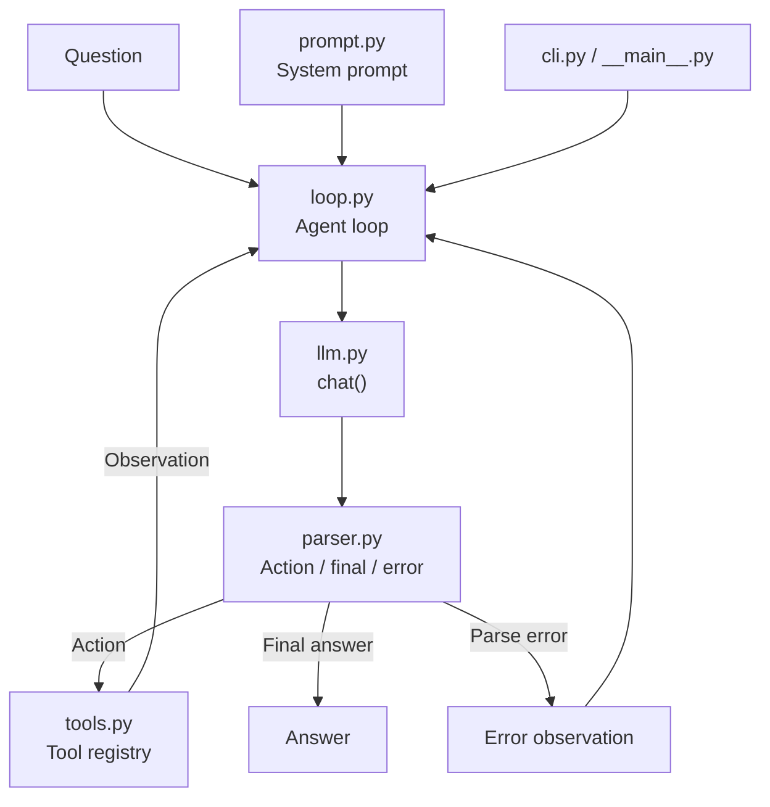

# ReAct Agent From Scratch

A compact **ReAct (Reason + Act) agent implemented in Python**, without an agent framework. A language model can select a tool, receive its output as an observation, and continue until it returns a final answer or reaches the configured iteration limit.

The implementation separates prompt construction, response parsing, model access, tool execution, and orchestration into focused modules. This keeps the control flow explicit and provides clear boundaries for testing and extension.

> **Current status:** The core implementation, CLI, and deterministic test suite are in place. Latest reported local validation: **81 passed, 1 skipped**; Ruff: **All checks passed**. These results describe the reported local environment, not a guarantee across platforms. A small manually run model-evaluation set (E01–E10) provides capability-focused observations; it is not a statistically representative benchmark.

## Contents

- [Project overview](#project-overview)
- [Engineering highlights](#engineering-highlights)
- [How it works](#how-it-works)
- [Architecture](#architecture)
- [Project structure](#project-structure)
- [Requirements](#requirements)
- [Quick start](#quick-start)
- [Configuration](#configuration)
- [Run the agent](#run-the-agent)
- [Use it from Python](#use-it-from-python)
- [Tools and security boundaries](#tools-and-security-boundaries)
- [Testing and validation](#testing-and-validation)
- [Model evaluation and timing trace](#model-evaluation-and-timing-trace)
- [Design decisions and trade-offs](#design-decisions-and-trade-offs)
- [Limitations](#limitations)
- [Roadmap](#roadmap)
- [License](#license)

## Project overview

This repository implements a single-agent ReAct workflow with an explicit orchestration loop. It includes:

- A provider-independent `chat()` interface for supported Ollama and OpenAI configurations.
- A text-based ReAct prompt and parser for tool actions and final answers.
- An orchestration loop that executes one tool action at a time, feeds observations back to the model, records LLM-call durations, and enforces an iteration limit.
- Three tools: an arithmetic calculator, a deterministic offline fact lookup, and a file reader scoped to `data/`.
- A command-line interface and deterministic automated tests.

## Engineering highlights

- **Explicit orchestration:** The control loop is implemented in the repository rather than delegated to an agent framework.
- **Restricted arithmetic evaluation:** The calculator parses expressions with Python's AST and evaluates only an allowlist of numeric operations; it does not use `eval()`.
- **Provider boundary:** Provider-specific API interaction stays behind `chat()`, keeping the agent loop independent of the selected supported provider.
- **Bounded execution:** The loop has a configurable iteration limit, and tool failures are returned to the model as observations.
- **Testable behavior:** Scripted model responses and fake clients cover the normal test path without requiring a live model or API credentials.

## How it works

1. The model receives the question, system instructions, and available tool descriptions.
2. It returns either an action or a final answer in the expected text format.
3. The parser converts the response into an action, final answer, or parse error.
4. For an action, the loop runs the matching tool and appends the result as an `Observation`.
5. The loop asks the model again, stopping when it receives a final answer or reaches `max_iters`.

Example exchange (illustrative output):

```text
Thought: I need the height of the Eiffel Tower.
Action: search
Action Input: height of eiffel tower
Observation: The Eiffel Tower is about 330 meters tall.
Thought: I can double that value.
Action: calculator
Action Input: 330*2
Observation: 660
Final Answer: 660 meters
```

The program adds `Observation` after executing a tool; it does not accept the model's claim as the tool result. The loop records the duration of each complete `llm()` call in the trace as `llm_duration_seconds`. This is total call duration, not isolated model-inference time.

## Architecture



## Project structure

```text
src/react_agent/
├── config.py       # Provider and model settings
├── llm.py          # Thin model interface: chat()
├── prompt.py       # System prompt and tool instructions
├── parser.py       # Model text -> action, final answer, or error
├── tools.py        # Calculator, fixed-fact search, file lookup
├── loop.py         # ReAct orchestration and iteration limit
├── cli.py          # Command-line interface
└── __main__.py     # python -m react_agent entry point

tests/              # Automated tests
data/notes.txt      # Sample file for file_lookup
.env.example        # Example environment configuration
```

| Module | Responsibility |
|---|---|
| `config.py` | Reads provider, model, and Ollama URL settings from environment variables / `.env`. |
| `llm.py` | Exposes `chat()` and contains provider-specific API interaction. |
| `prompt.py` | Builds system instructions from the available tool descriptions. |
| `parser.py` | Parses model text into an action, final answer, or error. |
| `tools.py` | Defines the tool contract and registers the calculator, fixed-fact search, and file reader. |
| `loop.py` | Validates and maps tools, calls the model, parses each response, executes tools, feeds observations back, records per-call LLM duration, and enforces the iteration limit. |
| `cli.py` | Parses arguments, prints the trace, and returns a success/limit exit code. |

## Requirements

- Python **3.13 or newer**
- [`uv`](https://docs.astral.sh/uv/) for environment and dependency management
- [Ollama](https://ollama.com/) for the default local-provider setup, or a supported OpenAI API configuration

## Quick start

Run these commands in PowerShell:

```powershell
git clone https://github.com/sadrjahani/react-agent-from-scratch.git
cd react-agent-from-scratch
uv sync
Copy-Item .env.example .env
ollama pull phi4-mini
```

Edit `.env` to match the model you pulled:

```dotenv
LLM_PROVIDER=ollama
LLM_MODEL=phi4-mini
OLLAMA_BASE_URL=http://localhost:11434/v1
```

Start Ollama and make sure the selected model is available before running the agent.

## Configuration

Configuration is read from environment variables, normally supplied through `.env`.

| Variable | Purpose |
|---|---|
| `LLM_PROVIDER` | Supported values are `ollama` and `openai`; defaults to `ollama`. |
| `LLM_MODEL` | Model name required by the selected provider. |
| `OLLAMA_BASE_URL` | Ollama's OpenAI-compatible API base URL; defaults to `http://localhost:11434/v1`. |
| `OPENAI_API_KEY` | Credential read by the OpenAI SDK for the `openai` provider. Never commit real credentials. |
| `OPENAI_BASE_URL` | Optional endpoint override supported by the OpenAI SDK. |

The request timeout is currently configured in code as **300 seconds**. `LLM_MODEL` is required; the application does not supply a default model name. The `.env.example` file uses `phi4-mini` as an example value. For OpenAI, the SDK reads `OPENAI_API_KEY` and the optional `OPENAI_BASE_URL` from the environment. Never commit real credentials.

## Run the agent

With Ollama running and the configured model available:

```powershell
uv run python -m react_agent "What is twice the height of the Eiffel Tower?"
uv run python -m react_agent "Read notes.txt" --max-iters 10
```

The CLI prints each model step and any tool observations after the run returns; it does **not** stream tokens during generation. The final answer is printed once from the parsed result, while the final step's `Final Answer:` section is omitted from the raw trace display to avoid duplication.

`--max-iters` defaults to `6` and limits model calls. The CLI returns exit code `0` when a final answer is reached and `1` when the iteration limit is reached first.

The project also declares a `react_agent` console-script entry point. After installation, you can try:

```powershell
uv run react_agent "What is 2+3?"
```

If that command is unavailable in your environment, use the module command shown above.

## Use it from Python

```python
from react_agent.loop import run_agent
from react_agent.tools import TOOLS

result = run_agent("What is 2+3?", TOOLS)

print(result["answer"])
print(result["finished"])

for step in result["trace"]:
    print(step["step"], step["model"])
    if "observation" in step:
        print("  ->", step["observation"])
```

`run_agent()` accepts an `llm` callable compatible with `chat()`. This lets tests use scripted model responses without network access or API credentials. The CLI also accepts an injected LLM callable for integration tests.

## Tools and security boundaries

- **`calculator`** — Uses an AST allowlist instead of Python's `eval`. It supports numeric constants, `+`, `-`, `*`, `/`, `**`, unary signs, and parentheses. Expression length is capped at 200 characters and the absolute exponent at 100.
- **`search`** — An offline deterministic lookup over four facts bundled with the project. It matches a query against those facts and returns a stored answer. It does not perform web searches or retrieve live information.
- **`file_lookup`** — Reads UTF-8 text from `data/`, resolves the path, rejects paths outside that directory, and returns at most 2,000 characters.

The file reader resolves both the data directory and requested path before checking containment, so ordinary `..` traversal and paths resolving outside `data/` are rejected. The `data/` directory is resolved relative to the process working directory, so run the application from the repository root unless you intentionally configure the working directory and data layout accordingly. It returns an error string for a missing or outside path and for non-UTF-8 text. Unexpected file I/O errors can still raise and are converted by the agent loop into an error observation. The 2,000-character limit is applied to the returned text after reading; it is not a strict byte-level I/O limit. This file tool is not a hardened sandbox for untrusted multi-user workloads.

The calculator parses expressions with `ast.parse(..., mode="eval")` and recursively evaluates only numeric constants and explicitly allowlisted arithmetic operators. It does not call Python `eval()`. Unsupported syntax, overly long expressions, and excessive exponents raise errors; the loop converts tool exceptions into `Error: tool failed: ...` observations. If the query does not match one of the configured facts, the search tool returns `No results found.`

## Testing and validation

Run the deterministic suite and linter:

```powershell
uv run pytest -q
uv run ruff check .
git diff --check
```

**Latest reported local validation:**

```text
81 passed, 1 skipped
Ruff: All checks passed!
```

These results describe the reported local environment and may differ on other platforms. The skipped test attempts to create a symbolic link pointing outside `data/`; symlink creation was not permitted in the reported Windows environment, so that test did not execute there. The path-containment implementation is present, but this specific test still needs to run in an environment that permits symlink creation.

The CLI-specific suite most recently reported `5 passed`. The latest full-suite run included the symlink test and reported `81 passed, 1 skipped`.

Tests use fake clients, scripted model responses, and controlled files; the normal test suite does not require a live provider. The CLI integration test exercises the real CLI-to-agent/parser/tool path with a fake LLM. It is not a live-provider end-to-end smoke test.

| Test module | Main coverage |
|---|---|
| `test_llm.py` | Provider/configuration validation and model-client behavior with controlled test doubles. |
| `test_parser.py` | Action/final/error parsing and malformed output. |
| `test_prompt.py` | Prompt structure, tool descriptions, and format contract. |
| `test_tools.py` | Calculator constraints, fixed-fact search, file boundaries (including traversal, absolute paths, and symlink escape), encoding, missing files, and truncation. The symlink test was skipped in the reported Windows run because symlink creation was unavailable. |
| `test_loop.py` | Agent orchestration, tool observations, error recovery, and iteration limits. |
| `test_cli.py` | CLI arguments/output/exit behavior and CLI-to-agent integration with a fake LLM. |

Parser behavior worth knowing: `<think>...</think>` blocks (including an unclosed block through end-of-text) are removed before parsing. A valid action takes precedence over a later `Final Answer:` in the same model response, so the tool is run before accepting a final answer. Empty tool names or inputs and malformed action formats become parse errors that the loop returns to the model as observations.

The loop converts parser errors, unknown tool names, and tool-function exceptions into `Error:` observations. It does not execute a tool action on the final allowed model call because there would be no subsequent call to consume the observation. Exceptions raised by the LLM call itself are not converted into tool observations and can propagate to the caller.

## Model evaluation and timing trace

A small capability-focused evaluation set (E01–E10) was run with `qwen3:4b-instruct-2507-q4_K_M`. These cases exercise calculator use, fixed-fact search, direct answers, file lookup, and basic tool-selection behavior. They are exploratory project checks, not a representative benchmark or a statistically meaningful estimate of general task success.

Recorded observations:

- Calculator, fixed-fact search, direct-answer, and sample-file lookup cases passed in the latest reported runs.
- A path-traversal attempt using `../pyproject.toml` was rejected with an outside-data-folder error. The security property should be enforced by the tool implementation and tests, not by relying on the model to behave safely.
- For a simple arithmetic question without an explicit tool instruction, the model answered directly in four observed runs. When explicitly asked to use the calculator, it used the tool in the tested cases.
- One calculation explanation contained irrelevant intermediate reasoning even though the user-visible final answer and verification were correct. Evaluation should distinguish user-visible answer quality from intermediate model text.

The agent trace includes `llm_duration_seconds` for each model call. It measures the elapsed time around the complete `llm()` function call, which can include client setup, HTTP/network waiting, model generation, response transfer, and SDK processing. It is **not** a measurement of pure model inference time. These timing values are useful for inspecting individual runs, but this project does not currently provide a formal, repeatable benchmarking harness or make general performance claims about the models.

## Design decisions and trade-offs

### Build the loop explicitly

The loop, prompt, parser, and tools are implemented in the repository instead of delegated to an agent framework. This keeps orchestration behavior visible and testable. The trade-off is that the project does not include the reliability features and integrations of a mature framework.

### Keep a thin model interface

The rest of the agent calls `chat()` rather than embedding provider-specific API logic in the loop. This keeps orchestration provider-independent within the supported configurations, while limiting access to provider-specific capabilities.

### Use text-based ReAct

A textual contract such as `Action:` and `Action Input:` is easy to inspect, but models may violate the format. Parser errors and tool failures can be returned as observations for recovery, but successful completion is not guaranteed.

### Test without a live model

Fake clients and scripted responses keep tests fast, deterministic, and free of API cost. Mocked tests cannot prove that a real model will follow the prompt; a separate smoke test and evaluation set are still needed.

### Bound the agent and tools

The iteration limit prevents an unbounded loop, the calculator allowlist avoids arbitrary Python execution, and the file tool restricts paths and returned text. These are useful boundaries, not a claim that the whole application is production-hardened.

## Limitations

- The `search` tool is intentionally limited to the four bundled facts; questions outside that small set require a separate search integration.
- The agent performs one tool action per model turn and does not execute tools in parallel.
- Small models may not follow the text format consistently.
- A run may reach the iteration limit without a final answer.
- The CLI prints the trace after completion instead of streaming tokens.
- The file tool limits returned characters but is not a comprehensive filesystem security boundary.
- The small real-model evaluation set and per-call timing trace do not establish general model quality, performance, or cost.

## Roadmap

Potential future improvements:

- Add an independent web search integration alongside the existing offline local lookup.
- Expand the model evaluation set and define a repeatable evaluation protocol.
- Improve observability with structured execution logs and richer trace metadata.

## License

Distributed under the [MIT License](LICENSE).
