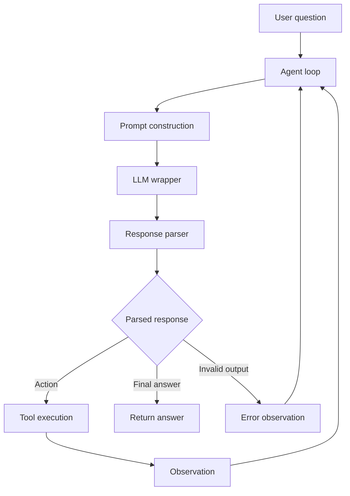

# React Agent From Scratch

A small educational implementation of a **ReAct (Reasoning + Acting) agent** in Python.

The project makes the core agent workflow explicit: a language model decides whether to answer or use a tool, the application parses that decision, executes the requested tool, returns the result as an observation, and repeats until a final answer is produced or the iteration limit is reached.

> **Status:** educational prototype. The latest development results reported for this project were **79 passing tests** and a clean Ruff check. Re-run the checks in your own checkout to verify its current state.

## Contents

- [Overview](#overview)
- [How ReAct works](#how-react-works)
- [Architecture](#architecture)
- [Features](#features)
- [Getting started](#getting-started)
- [Configuration](#configuration)
- [CLI usage](#cli-usage)
- [Python usage](#python-usage)
- [Project structure](#project-structure)
- [Design decisions](#design-decisions)
- [Testing](#testing)
- [Limitations](#limitations)
- [Possible next steps](#possible-next-steps)

## Overview

A conventional program follows a predefined sequence of operations. A ReAct agent adds a model-driven decision step: based on the user's question and the observations collected so far, the model can choose an available action or return a final answer.

This repository is intentionally compact. Its purpose is to make the main components understandable and testable:

- model interaction behind a provider-independent wrapper;
- prompt construction and the ReAct interaction format;
- parsing model output into an action or final answer;
- tool selection and execution;
- returning tool observations to the model;
- handling tool failures and bounding the loop.

The goal is to understand agent mechanics, not to provide a production-ready autonomous system.

## How ReAct works

1. Receive the user's question.
2. Ask the language model what to do next.
3. Parse the model's response.
4. If it requests a tool, execute that action.
5. Add the tool result as an **Observation**.
6. Ask the model to continue with the new observation.
7. Stop when the model returns a final answer or the iteration limit is reached.

For example, for `What is 25 * 4?`, the model can request the calculator tool. The tool returns `100`, and the model uses that observation to produce a final answer.

## Architecture



The loop coordinates the process without needing to know provider-specific details or the internal implementation of each tool.

## Features

- **ReAct loop** that alternates between model decisions and tool observations.
- **Provider integration** for Ollama and Groq through the project's LLM wrapper.
- **Response parser** for actions and final answers.
- **Built-in tools:**
  - **Calculator:** evaluates supported arithmetic expressions with restrictions rather than unrestricted Python execution.
  - **Search:** searches a small, predefined demonstration dataset; it is not general-purpose internet search.
  - **File lookup:** looks up files within the project's data area.
- **Iteration limit** through `max_iters`.
- **CLI** runnable as a Python package.
- **Automated tests** and Ruff linting.

## Getting started

The project uses Python and `uv` for environment and dependency management. Check `pyproject.toml` for the authoritative Python version and dependencies.

Clone the repository and enter its directory:

```powershell
git clone <repository-url>
cd react-agent-from-scratch
```

Install dependencies:

```powershell
uv sync
```

Create a `.env` file in the project root and configure the model provider as described in the next section. Then run:

```powershell
uv run python -m react_agent "What is 25 * 4?"
```

The repository URL is intentionally a placeholder here; use the actual remote URL configured for your repository.

## Configuration

Configuration is handled by the project's settings/configuration module and environment variables. Do not commit API keys or other secrets.

The project has integrations for:

- **Ollama**, for a locally served model.
- **Groq**, for a hosted model through the provider integration.

Use the current `src/react_agent/config.py` and any `.env.example` in your checkout as the source of truth for exact variable names, defaults, model identifiers, and provider-specific options. Those details should not be guessed in documentation because they can change between revisions.

For Ollama, make sure the Ollama service is running and the configured model is available locally. For Groq, provide a valid API key and a model supported by the account/API.

## CLI usage

Run a question:

```powershell
uv run python -m react_agent "What is 25 * 4?"
```

Set the maximum number of iterations:

```powershell
uv run python -m react_agent "What is 25 * 4?" --max-iters 8
```

`--max-iters` is a safety bound on the number of agent iterations/model decisions. It is not a performance option; lowering it does not necessarily make a run faster.

The CLI prints the result after the agent run returns. It should not be described as live token-by-token streaming.

**Command note:** `python -m react_agent` was verified in the reported project state. A shorter command such as `uv run react_agent` is only available if a matching console-script entry is defined in `pyproject.toml`.

## Python usage

The agent can also be called from Python. The following is an illustrative usage pattern; confirm the current public function signature and return type in `src/react_agent/loop.py` before relying on it:

```python
from react_agent.loop import run_agent

answer = run_agent("What is 25 * 4?")
print(answer)
```

## Project structure

High-level guide to the modules discussed during development. The exact tree may contain additional files:

```text
react-agent-from-scratch/
├── src/
│   └── react_agent/
│       ├── __main__.py     # python -m react_agent entry point
│       ├── cli.py          # command-line interface
│       ├── config.py       # settings and provider configuration
│       ├── llm.py          # model wrapper
│       ├── loop.py         # ReAct orchestration
│       ├── parser.py       # action/final-answer parsing
│       ├── prompt.py       # prompt construction
│       └── tools/          # tool implementations and registry
└── tests/
    └── test_cli.py         # CLI tests, alongside other test modules
```

## Design decisions

### A small model wrapper

The agent loop should not need provider-specific branching. A narrow wrapper separates orchestration from Ollama/Groq details and makes provider changes easier.

### Parsing separate from orchestration

The parser interprets model output; the loop decides what to do next. Keeping these responsibilities separate makes both easier to test.

### Tool errors become observations

A tool-execution failure is returned to the model as an observation, allowing the agent to react to the failure instead of crashing on an ordinary tool error. This is a deliberate tool-execution boundary, not a claim that every possible application or provider error is swallowed.

### A bounded loop

An iteration limit prevents unbounded agent execution. It does not guarantee that a task will be solved within the configured limit.

### Explicit components instead of a framework

The loop, parser, prompt, tools, and model wrapper remain visible. This is useful for learning because the framework does not hide the control flow.

## Testing

Run the test suite:

```powershell
uv run pytest -q
```

Run Ruff:

```powershell
uv run ruff check .
```

Latest results reported during development:

- `79 passed`
- `All checks passed!` from Ruff

Re-run both commands after changes; results depend on the current code and environment.

## Limitations

- The search tool uses a fixed demonstration dataset; it does not search the live web.
- The agent can use only the tools implemented in this repository.
- Model output is not deterministic; different providers or models may choose different actions or wording.
- Model calls add latency. Even a simple arithmetic question may require a model decision, a tool call, and another model decision.
- File lookup is intended for bounded project data, not unrestricted filesystem access. Verify path restrictions and output limits against the current tool implementation.
- The project does not claim production-grade security, observability, persistence, concurrency, or resilience.

For simple, predictable operations, a direct Python function is usually faster and simpler than an agent. The agent pattern is more useful when a task benefits from model-driven tool selection or handling less structured requests.

## Possible next steps

These are optional extensions, not existing features:

- measure end-to-end latency and individual model-call duration before optimizing;
- add structured logging/tracing for each reasoning, action, and observation step;
- add more narrowly scoped tools with explicit input validation;
- connect a retrieval tool to a RAG system for document-grounded research;
- add streaming if live incremental output becomes a project goal.

---

## License

Add the license and attribution information that applies to this repository. Do not imply that the project has an open-source license unless one has been selected and included.
